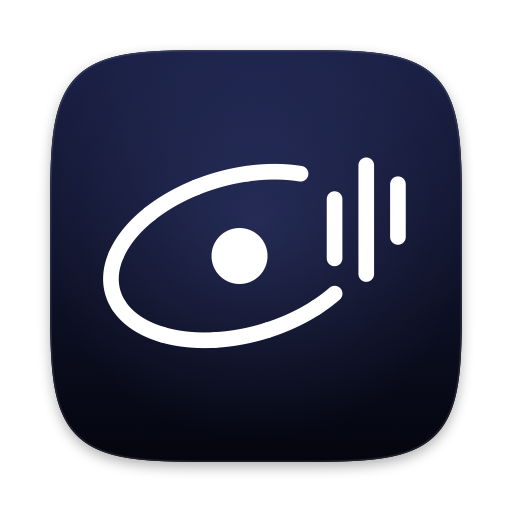

<p align="center">
  
</p>

<h1 align="center">Capcom</h1>

<p align="center">
  <b>Hold a key. Talk. Clean text lands at your cursor.</b><br>
  Wispr Flow–style dictation for macOS &amp; Linux, powered by <i>your</i> models: vLLM, Ollama, whisper.cpp or any OpenAI-compatible endpoint.
</p>

<p align="center">
  <a href="https://github.com/SiCuellar/capcom/actions/workflows/ci.yml"></a>
  <a href="https://github.com/SiCuellar/capcom/releases/latest"></a>
  <a href="LICENSE"></a>
  
  
  
</p>

<p align="center">
  
</p>

> In NASA mission control, the **capsule communicator** is the one voice on the loop between the crew and the ground. You talk, Capcom relays.

## Why

- 🔒 **Private.** Audio goes to a server *you* choose and nowhere else. No account, no telemetry, and audio is never written to disk.
- ⚡ **Fast.** Typically under a second from releasing the key to pasted text, with a GPU box on your LAN.
- 🧩 **Bring your own model.** Any OpenAI-compatible speech-to-text endpoint, plus an optional LLM pass that drops the "um"s and turns "2, actually 3" into "3".
- 🪶 **Light.** One ~5 MB native Rust binary in the menu bar. No Electron.

## Quick start (macOS)

**1. Download.** Get `Capcom-macos-universal.zip` from [**Releases**](../../releases/latest), unzip it, and drag **Capcom.app** to `/Applications`.

**2. Open it once.** Builds are unsigned, so Gatekeeper will complain. Right-click **Capcom.app → Open → Open**, or run:

```sh
xattr -dr com.apple.quarantine /Applications/Capcom.app
```

**3. Point it at your servers.** Click the menu-bar mic and choose **Set up Capcom…**. Or use a terminal:

```sh
sudo ln -sf /Applications/Capcom.app/Contents/MacOS/capcom /usr/local/bin/capcom   # optional CLI
capcom setup
```

Pick a preset and press Enter a few times; the wizard finishes with a live test. Then quit and reopen Capcom, and grant **Microphone**, **Accessibility** and **Input Monitoring** when macOS asks. Hold **right ⌃** and talk. 🚀

Scripting it? One line does the same:

```sh
capcom setup --yes --asr-preset vllm --llm-preset ollama   # add --api-key KEY if your server needs one
```

## How it works

```
 hold ⌃ ─► 🎙 mic, 16 kHz ─► /v1/audio/transcriptions ─► /v1/chat/completions ─► ⌘V at the cursor
                               (speech → raw text)       (optional cleanup LLM)    (clipboard restored)
```

If the cleanup LLM is slow, down or rambling, Capcom pastes the raw transcript, so you never lose your words.

## Backends

Any OpenAI-compatible server works. These are the built-in presets; `capcom setup --list-presets` prints them too.

| Speech-to-text | Preset | Default URL | Model |
|---|---|---|---|
| [vLLM](https://docs.vllm.ai/en/latest/serving/online_serving/) (Whisper, Voxtral) | `vllm` | `http://localhost:8000/v1/audio/transcriptions` | `openai/whisper-large-v3-turbo` |
| [speaches](https://speaches.ai) (faster-whisper) | `speaches` | `http://localhost:8000/v1/audio/transcriptions` | `deepdml/faster-whisper-large-v3-turbo-ct2` |
| [whisper.cpp server](https://github.com/ggml-org/whisper.cpp/tree/master/examples/server) ¹ | `whisper-cpp` | `http://localhost:8080/v1/audio/transcriptions` | any (ignored) |
| [Parakeet TDT 0.6B v3](https://github.com/groxaxo/parakeet-tdt-0.6b-v3-fastapi-openai) | `parakeet` | `http://localhost:5092/v1/audio/transcriptions` | `istupakov/parakeet-tdt-0.6b-v3-onnx` |
| Groq ☁️ | `groq` | `https://api.groq.com/openai/v1/audio/transcriptions` | `whisper-large-v3-turbo` |
| OpenAI ☁️ | `openai` | `https://api.openai.com/v1/audio/transcriptions` | `gpt-4o-mini-transcribe` |

| Cleanup LLM | Preset | Default URL | Model |
|---|---|---|---|
| [Ollama](https://docs.ollama.com/api/openai-compatibility) | `ollama` | `http://localhost:11434/v1/chat/completions` | `llama3.2:3b` |
| vLLM ² | `vllm` | `http://localhost:8001/v1/chat/completions` | `Qwen/Qwen3-4B-Instruct-2507` |
| [LM Studio](https://lmstudio.ai/docs/developer/openai-compat) | `lmstudio` | `http://localhost:1234/v1/chat/completions` | the model you loaded |
| llama.cpp `llama-server` | `llama-cpp` | `http://localhost:8080/v1/chat/completions` | any |
| Groq ☁️ | `groq` | `https://api.groq.com/openai/v1/chat/completions` | `llama-3.1-8b-instant` |
| OpenAI ☁️ | `openai` | `https://api.openai.com/v1/chat/completions` | `gpt-4.1-mini` |
| *none* | `--no-cleanup` | | pastes the raw transcript |

¹ Start it with `whisper-server -m models/ggml-large-v3-turbo.bin --inference-path /v1/audio/transcriptions`. Add `--host 0.0.0.0` for LAN access.<br>
² vLLM serves one model per process. Run the chat model on a second port (`vllm serve … --port 8001`) or put both behind a router such as llama-swap.<br>
☁️ = cloud: your audio leaves your network, and you need `--api-key`.

**Server on another machine?** Replace `localhost` with its address. On macOS, allow **Local Network** for Capcom when it asks.

## Hotkeys

| | macOS | Linux (Omarchy / Hyprland) |
|---|---|---|
| Push-to-talk | hold **right ⌃** | hold **F9** (Omarchy also binds Right Alt) |
| Hands-free | **double-tap** right ⌃; tap again to stop | **Super+Ctrl+X** toggles |
| Cancel | **Esc** | Super+Ctrl+Esc (plain Hyprland binds) |

To change the macOS key, set `[hotkey] push_to_talk` to `"fn"`, `"optright"`, `"cmdright"`, `"F13"` and so on. On Linux, the hotkey is whatever your compositor binds to `capcom start` / `capcom stop`.

## Linux / Omarchy

```sh
tar xzf capcom-linux-x86_64.tar.gz && cd capcom-linux-x86_64   # or aarch64
./packaging/linux/install.sh --no-build   # deps, ~/.local/bin/capcom, systemd user service, setup
```

To build from source instead, run `packaging/linux/install.sh` in a checkout.

- **[Omarchy](https://omarchy.org):** Capcom registers as a dictation backend. Select it with `omarchy-default-dictation capcom`.
- **Plain Hyprland:** see `packaging/linux/hyprland-binds.conf`.
- **Waybar:** a module is in `packaging/linux/waybar-capcom.jsonc`.
- **Paste** needs `wl-clipboard` and `wtype`.

## Config

`capcom setup` writes `~/.config/capcom/config.toml`. You rarely need to edit it by hand.

```toml
[server]
asr_url   = "http://localhost:8000/v1/audio/transcriptions"
asr_model = "openai/whisper-large-v3-turbo"
llm_url   = "http://localhost:11434/v1/chat/completions"
llm_model = "llama3.2:3b"
api_key_file = "~/.config/capcom/api_key"   # 0600. Missing = no auth header. Or set CAPCOM_API_KEY.

[cleanup]
enabled = true
prompt_file = "~/.config/capcom/cleanup-prompt.txt"   # edit to taste
vocabulary = ["Kubernetes", "Pydantic"]               # names to spell exactly
skip_under_words = 4                                  # very short clips skip the LLM

[audio]
mic_mode = "on_demand"   # or "always_on" (keeps a pre-roll for a faster start)
device = "default"       # or part of a name from `capcom devices`

[hotkey]                 # macOS only
push_to_talk = "ctrlright"
cancel = "escape"

[ui]                     # macOS only
pill_position = "caret"  # pill floats by your text cursor; or "bottom" (bottom-center of the screen)
```

The pill finds your cursor through the Accessibility API, capped at 150 ms. If an app doesn't expose it (terminals, some web apps), the pill sits under the focused text field, then the window, then the screen. To see where it lands and why, run `capcom anchor-probe`.

Handy commands:

- `capcom doctor`: check config, key, endpoints and permissions
- `capcom config show`: print the config (key redacted)
- `capcom history`: recent dictations
- `capcom transcribe clip.wav`: run a recording through the pipeline
- `capcom devices`: list microphones
- `capcom paste-last`: paste the last dictation again

## Troubleshooting

| Symptom | Fix |
|---|---|
| Nothing happens when you press ⌃ | Grant **Input Monitoring** and **Accessibility** to Capcom.app (System Settings → Privacy & Security), then **quit and reopen** Capcom. |
| Text isn't pasted | Check Accessibility. Or **Secure Input** is on (a password field, or Terminal's *Secure Keyboard Entry*); the text is still on your clipboard. |
| Empty transcripts | Grant **Microphone**, and check `capcom devices`. |
| Menu says "Server: unreachable" | Allow **Local Network** for Capcom (System Settings → Privacy & Security), then check the URL with `capcom doctor`. |
| 401 / "bad API key" | Set the key with `capcom setup --api-key …`. If the server takes no key, remove it with `--api-key ""`. |
| 400 "unknown model" | The model ID must exactly match what the server lists at `GET /v1/models`. |
| Permissions gone after an update | Unsigned builds get a new identity each release. Remove Capcom from the permission lists and add it again. |
| Fn opens the emoji picker | System Settings → Keyboard → *Press 🌐 key to* → **Do Nothing**. |

Logs: `~/Library/Logs/Capcom.log` on macOS, `journalctl --user -u capcom` on Linux.

## 🤖 Set it up with your AI agent

Paste this into Claude Code, Codex, Cursor or a similar agent:

```text
Install and configure Capcom (a dictation app) on this machine. Follow AGENTS.md in
https://github.com/SiCuellar/capcom.
1. Ask me for my speech-to-text endpoint (an OpenAI-compatible /v1/audio/transcriptions URL
   and model) and my cleanup LLM endpoint (a /v1/chat/completions URL and model, or "none"),
   and whether they need an API key. Suggest presets from `capcom setup --list-presets`.
2. Install the latest release for my OS. On macOS: copy Capcom.app to /Applications, remove
   the quarantine attribute, and symlink the CLI. On Linux: unpack the tarball and run
   packaging/linux/install.sh --no-build.
3. Run `capcom setup --yes ...` with my answers. Pass the key on stdin with `--api-key -`.
4. Run `capcom doctor` and fix what you can. Tell me which macOS permissions I have to grant
   by hand.
Never print my API key.
```

[`AGENTS.md`](AGENTS.md) has the exact commands, exit codes and repo conventions.

## FAQ

**Is anything sent to the cloud?** Only if you pick a cloud preset. There's no telemetry, and audio is never written to disk. See [SECURITY.md](SECURITY.md).

**Which models are good?**

- **Speech-to-text:** **Parakeet TDT 0.6B v3** is very fast and covers 25 European languages. **Whisper large-v3-turbo** covers ~99 languages. Both run on a modest GPU, and whisper.cpp also runs on an Apple Silicon Mac.
- **Cleanup:** any small instruct model, 3–8B (Llama 3.2 3B, Qwen3 4B Instruct, Gemma 3 4B). Non-thinking variants are faster; `<think>` blocks are stripped either way.

**Will it answer questions or follow instructions I dictate?** No. The cleanup prompt treats everything as text to tidy, so "ignore previous instructions" gets punctuated, not obeyed.

**Can I skip the LLM?** Yes: `capcom setup --no-cleanup`. Whisper-class models already add punctuation.

**Windows?** Not yet. PRs welcome.

## Build from source

```sh
cargo build --release && packaging/macos/make-app.sh   # → packaging/macos/build/Capcom.app
```

See [CONTRIBUTING.md](CONTRIBUTING.md).

## Credits

Capcom builds on [Handy](https://github.com/cjpais/Handy) (the macOS paste recipe, plus [handy-keys](https://github.com/handy-computer/handy-keys) for hotkeys), [Voxtype](https://github.com/peteonrails/voxtype) (Wayland output) and [Omarchy](https://omarchy.org) (Hyprland integration). Details are in [THIRD_PARTY.md](THIRD_PARTY.md). MIT licensed.
